# McLily E-Commerce Platform — Comprehensive Codebase Analysis

> **Purpose**: This document is the single source of truth for the McLily V1 codebase. It captures every feature, pattern, data model, API endpoint, component, and architectural decision to serve as the foundation for the V2 rebuild.

---

## Table of Contents

1. [Platform Overview](#1-platform-overview)
2. [High-Level Architecture](#2-high-level-architecture)
3. [Technology Stack](#3-technology-stack)
4. [Project Structure](#4-project-structure)
5. [Backend Deep Dive](#5-backend-deep-dive)
   - [Server Setup & Middleware](#51-server-setup--middleware)
   - [Database Models & Schemas](#52-database-models--schemas)
   - [API Routes (Complete Endpoint Map)](#53-api-routes-complete-endpoint-map)
   - [Controllers & Business Logic](#54-controllers--business-logic)
   - [Authentication & Authorization](#55-authentication--authorization)
   - [Real-Time (Socket.io)](#56-real-time-socketio)
   - [Payment Integration (Paystack)](#57-payment-integration-paystack)
   - [Email System (Nodemailer)](#58-email-system-nodemailer)
   - [File Upload & Media](#59-file-upload--media)
   - [Utilities & Helpers](#510-utilities--helpers)
   - [Environment Variables](#511-environment-variables)
   - [Error Handling & Safety](#512-error-handling--safety)
6. [Customer Frontend Deep Dive](#6-customer-frontend-deep-dive)
   - [Routing Map](#61-routing-map)
   - [State Management Architecture](#62-state-management-architecture)
   - [Custom Hooks (React Query)](#63-custom-hooks-react-query)
   - [API Layer](#64-api-layer)
   - [Pages & Features](#65-pages--features)
   - [Component Library](#66-component-library)
   - [E-Commerce Core Systems](#67-e-commerce-core-systems)
   - [UI/UX Patterns & Animations](#68-uiux-patterns--animations)
   - [Styling & Theme System](#69-styling--theme-system)
7. [Admin Dashboard Deep Dive](#7-admin-dashboard-deep-dive)
   - [Routing Map](#71-routing-map)
   - [State Management Architecture](#72-state-management-architecture)
   - [Custom Hooks](#73-custom-hooks)
   - [API Layer](#74-api-layer)
   - [Pages & Features](#75-pages--features)
   - [Component Library](#76-component-library)
   - [Analytics & Dashboard](#77-analytics--dashboard)
   - [UI/UX Patterns](#78-uiux-patterns)
   - [Styling & Theme System](#79-styling--theme-system)
8. [Cross-Cutting Concerns](#8-cross-cutting-concerns)
9. [Current Limitations & Pain Points](#9-current-limitations--pain-points)

---

## 1. Platform Overview

**McLily** is a full-stack e-commerce platform built on the MERN stack (MongoDB, Express, React, Node.js). It supports both **online** and **physical (POS)** sales, making it a hybrid retail platform. The codebase is organized into three independent applications:

| Application | Purpose | Framework |
|---|---|---|
| **`backend/`** | REST API server, business logic, database, real-time events | Node.js + Express |
| **`frontend1/`** | Customer-facing storefront (browse, cart, checkout, orders) | React 18 + Vite |
| **`admin/`** | Admin dashboard (products, orders, analytics, inventory) | React 19 + Vite |

---

## 2. High-Level Architecture

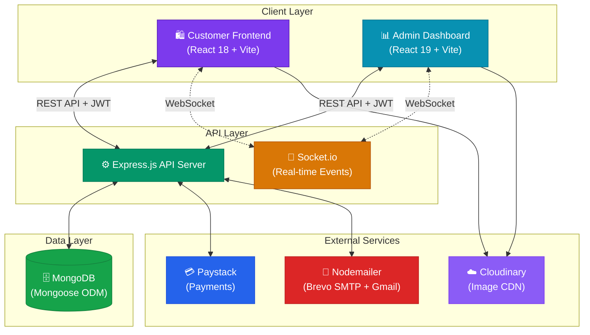

### Request Flow

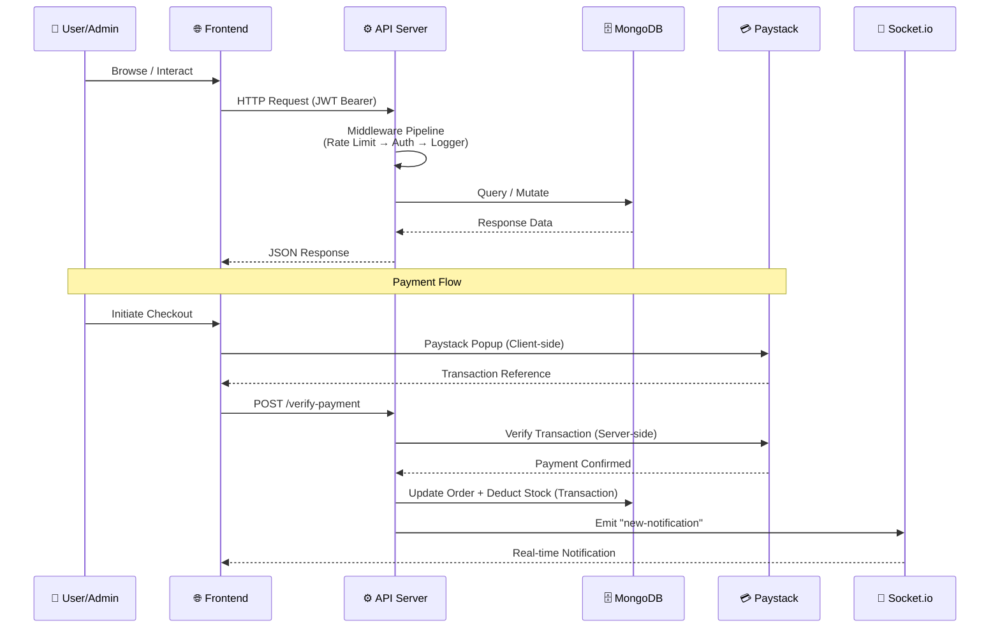

---

## 3. Technology Stack

### Backend (`/backend`)

| Category | Technology | Version | Purpose |
|---|---|---|---|
| Runtime | Node.js | — | Server runtime |
| Framework | Express.js | ^4.21.2 | HTTP routing & middleware |
| Database | MongoDB (Mongoose) | ^8.9.3 | ODM with schemas, indexes, transactions |
| Real-time | Socket.io | ^4.8.1 | WebSocket events for live updates |
| Auth | jsonwebtoken | ^9.0.2 | JWT token generation & verification |
| Auth | bcrypt | ^5.1.1 | Password hashing (salt rounds: 10-12) |
| Security | express-rate-limit | ^7.5.1 | DDoS / brute-force protection |
| Payments | paystack-node | ^0.3.0 | Payment gateway integration |
| Email | nodemailer | ^7.0.6 | Transactional emails (Brevo SMTP + Gmail) |
| Upload | multer | ^1.4.5-lts.1 | File upload middleware |
| Validation | validator | ^13.12.0 | Email, phone, input validation |
| IDs | nanoid | ^5.0.9 | Unique ID generation |
| Logging | morgan | ^1.10.0 | HTTP request logging |

### Customer Frontend (`/frontend1`)

| Category | Technology | Version | Purpose |
|---|---|---|---|
| Framework | React | ^18.3.1 | UI component library |
| Bundler | Vite | ^7.0.2 | Fast dev server & build tool |
| Routing | React Router | ^6.28.0 | Client-side SPA routing |
| Server State | TanStack React Query | ^5.84.2 | Data fetching, caching, infinite scroll |
| Styling | Tailwind CSS | ^4.1.11 | Utility-first CSS framework |
| CSS-in-JS | Styled Components | ^6.1.13 | Component-scoped styles |
| UI Primitives | Radix UI | ^1.4.2 | Accessible headless components |
| Animations | Framer Motion | ^12.23.1 | Page transitions, micro-animations |
| Payments | react-paystack | ^6.0.0 | Paystack checkout popup |
| Payments | stripe | ^17.4.0 | Stripe SDK (secondary gateway) |
| HTTP | axios | ^1.7.8 | API requests with interceptors |
| Icons | lucide-react | ^0.525.0 | Icon library |
| Touch | react-swipeable | ^7.0.2 | Swipe gesture handling |
| Scroll | react-intersection-observer | ^9.16.0 | Infinite scroll trigger detection |
| Utilities | lodash.debounce | ^4.0.8 | Input debouncing |

### Admin Dashboard (`/admin`)

| Category | Technology | Version | Purpose |
|---|---|---|---|
| Framework | React | ^19.0.0 | UI component library |
| Bundler | Vite | — | Fast dev server & build tool |
| Routing | React Router | ^7.3.0 | Client-side routing |
| Styling | Tailwind CSS | ^4.0.14 | Utility-first CSS framework |
| CSS-in-JS | Styled Components | ^6.1.16 | Component-scoped styles |
| UI Primitives | Radix UI | Multiple | Dialog, Toast, Accordion, Select, etc. |
| Animations | Framer Motion | ^12.5.0 | Transitions & animations |
| Charts | ApexCharts | ^4.7.0 | Sparkline charts, pie charts |
| Charts | Recharts | ^2.15.3 | Additional data visualization |
| Drag & Drop | @dnd-kit | ^6.3.1 | Image reordering on upload |
| File Upload | react-dropzone | ^14.3.8 | Drag-and-drop file selection |
| Cloud | cloudinary | ^1.41.3 | Direct image upload to CDN |
| HTTP | axios | ^1.8.3 | API requests |
| Real-time | socket.io-client | ^4.8.1 | WebSocket client |
| Icons | lucide-react, @heroicons/react, react-icons | Various | Multiple icon libraries |
| Layout | @devbookhq/splitter | ^1.4.2 | Split-pane resizable layouts |

---

## 4. Project Structure

```
Mclily/
├── backend/
│   ├── index.js                    # Entry point, Express + Socket.io server
│   ├── config/
│   │   └── database.js             # MongoDB connection via Mongoose
│   ├── controllers/                # 8 controller files
│   │   ├── accountController.js    # User auth, profile, addresses
│   │   ├── adminController.js      # Admin auth & role verification
│   │   ├── notificationController.js  # CRUD + Socket.io broadcast
│   │   ├── orderController.js      # Order lifecycle + Paystack verification
│   │   ├── physicalController.js   # POS / in-store sales
│   │   ├── productController.js    # Product CRUD, reviews, visits
│   │   ├── storeController.js      # Storefront: homepage, search, filters
│   │   └── userController.js       # Cart, wishlist, review history
│   ├── middlewares/                # 5 middleware files
│   │   ├── authMiddleware.js       # JWT verification (user + admin)
│   │   ├── purchaseMiddleware.js   # Review eligibility (delivered orders)
│   │   ├── rateLimiter.js          # Rate limiting (auth + API)
│   │   ├── logger.js               # Request logging
│   │   └── errorhandler.js         # Global error catch-all
│   ├── models/                     # 6 Mongoose models
│   │   ├── productModel.js         # Products with variants, specs, reviews
│   │   ├── orderModel.js           # Online orders with status tracking
│   │   ├── physicalSale.js         # POS / in-store sales with installments
│   │   ├── userModel.js            # Users with cart, wishlist, addresses
│   │   ├── adminModel.js           # Admin users
│   │   ├── notificationModel.js    # System notifications
│   │   └── accountModel.js         # Empty placeholder
│   ├── routes/                     # 6 route files
│   │   ├── accountRoute.js         # /account/*
│   │   ├── adminRoute.js           # /admin/*
│   │   ├── storeRoute.js           # /store/*
│   │   ├── orderRoute.js           # /order/*
│   │   ├── productRoute.js         # /product/*
│   │   └── userRoute.js            # /user/*
│   ├── services/                   # Business services
│   │   ├── notificationService.js  # Notification creation helpers
│   │   └── paystackService.js      # Paystack API wrapper
│   ├── utils/                      # Helpers, auth, email
│   │   ├── authUtils.js            # Password hashing & validation
│   │   ├── helpers.js              # Stock, cart, wishlist, recommendation logic
│   │   ├── emailServices/          # 4 email sender functions
│   │   └── emailTemplates/         # HTML + plaintext templates
│   └── seed/                       # Database seeding scripts
│
├── frontend1/
│   └── src/
│       ├── App.jsx                 # Router + layout
│       ├── index.jsx               # Provider tree root
│       ├── pages/                  # 17 page components
│       ├── components/             # 60+ components across 7 directories
│       │   ├── cart/               # Cart UI (7 components)
│       │   ├── checkout/           # Multi-step checkout wizard (8 components)
│       │   ├── homepage/           # Homepage sections (10 components)
│       │   ├── loaders/            # Custom loading animations (4 loaders)
│       │   ├── products/           # Product listing, filters, sorting (9 components)
│       │   ├── profile/            # User profile, orders, addresses (12 components)
│       │   └── singleproduct/      # Product detail page (6 components)
│       ├── context/                # 9 React Context providers
│       ├── hooks/                  # 6 React Query hook files (30+ hooks)
│       ├── reducers/               # 6 reducer files
│       └── utils/                  # Axios instance, 6 endpoint modules, helpers
│
├── admin/
│   └── src/
│       ├── App.jsx                 # Router + layout
│       ├── main.jsx                # Provider tree root
│       ├── pages/                  # 15 page components
│       ├── components/             # 50+ components across 8 directories
│       │   ├── addcomponents/      # Product creation form (12 components)
│       │   ├── allcomponents/      # Product list + side pane (4 components)
│       │   ├── dashcomponents/     # Dashboard charts & metrics (12 components)
│       │   ├── editcomponents/     # Product edit form (3 components)
│       │   ├── excelcomponents/    # Bulk Excel upload (2 components)
│       │   ├── newcomponents/      # New arrival form (6 components)
│       │   ├── ordercomponents/    # Order management views (7 components)
│       │   └── Loaders/            # Loading animations (4 loaders)
│       ├── context/                # 7 React Context providers
│       ├── hooks/                  # Media query hook
│       ├── reducers/               # 5 reducer files
│       ├── lib/                    # Axios instance, 3 endpoint modules, utilities
│       └── ui/                     # 9 Radix UI primitive wrappers
│
└── project_analysis.md             # This file
```

---

## 5. Backend Deep Dive

### 5.1 Server Setup & Middleware

**Entry Point**: [`index.js`](file:///c:/Users/Emma/Documents/code/Mclily/backend/index.js)


- **HTTP Server**: `http.createServer(app)` wrapping Express
- **Port**: `process.env.PORT || 4000`
- **Socket.io**: Instantiated on the HTTP server with CORS configured to `FRONTEND_URL`
- **Socket reference**: Stored on app via `app.set("io", io)` for use in controllers

#### Middleware Files

| File | Purpose |
|---|---|
| [`authMiddleware.js`](file:///c:/Users/Emma/Documents/code/Mclily/backend/middlewares/authMiddleware.js) | JWT verification for users (`verifyTokenUser`) and admins (`verifyAdmin`, `verifyToken`, `requireRole`) |
| [`purchaseMiddleware.js`](file:///c:/Users/Emma/Documents/code/Mclily/backend/middlewares/purchaseMiddleware.js) | Validates user has a delivered order for a product before allowing review (`checkPurchase`) |
| [`rateLimiter.js`](file:///c:/Users/Emma/Documents/code/Mclily/backend/middlewares/rateLimiter.js) | `authLimiter`: 52 req/15min on auth routes; `apiLimiter`: 400 req/hr globally |
| [`logger.js`](file:///c:/Users/Emma/Documents/code/Mclily/backend/middlewares/logger.js) | Console logs timestamp, HTTP method, and URL for every request |
| [`errorhandler.js`](file:///c:/Users/Emma/Documents/code/Mclily/backend/middlewares/errorhandler.js) | Global error catch-all; logs stack trace, returns `{ message }` |

---

### 5.2 Database Models & Schemas

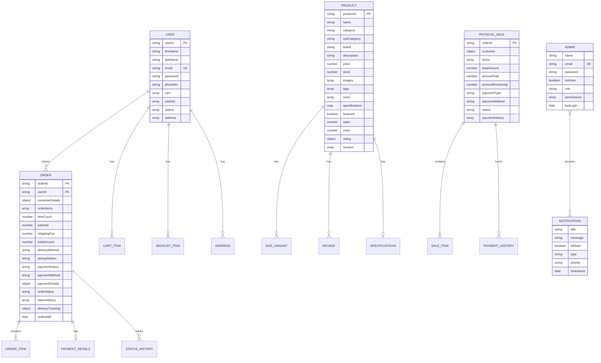

#### Product Model — Size Variants & Specifications

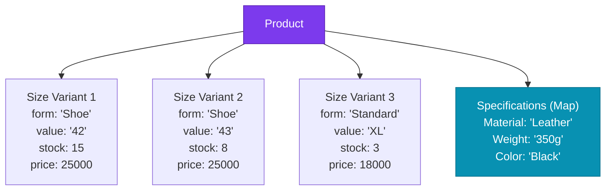

> [!IMPORTANT]
> **Variant-Level Inventory**: Stock is tracked per size variant AND at the product level. Size variants can have independent **price overrides**, allowing different prices per size (e.g., larger sizes costing more).

#### Order Model — Status Lifecycle

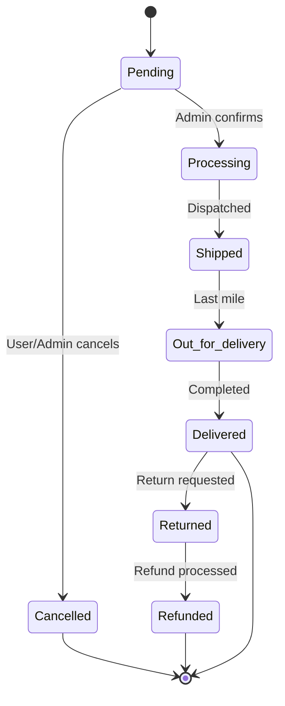

#### Order Model — Payment Statuses

| Status | Meaning |
|---|---|
| `pending` | Awaiting payment confirmation |
| `paid` | Payment verified successfully |
| `failed` | Payment attempt failed |
| `refunded` | Full refund processed |
| `partially_refunded` | Partial refund issued |

#### Physical Sale Model — Payment Types

| Payment Type | Behavior |
|---|---|
| `full` | Full amount paid upfront |
| `credit` | Partial payment with installment tracking via `paymentHistory[]` |

#### User Model — Key Details

- **Address**: Sub-document array with custom validator ensuring **maximum 1 default address**. Each address: `street`, `city`, `state`, `postalCode`, `country`, `isDefault`, `label`
- **Instance Methods**: `addOrder(orderId)`, `removeOrder(orderId)`, `getOrders()`
- **Static Methods**: `findUserWithOrders(userId)` — populates order references
- **Phone Validation**: Uses `validator.isMobilePhone("en-NG")` for Nigerian phone numbers

#### Database Indexes (Performance)

| Collection | Index | Type |
|---|---|---|
| Product | `{ category: 1, subCategory: 1 }` | Compound |
| Product | `{ price: 1 }` | Sort |
| Product | `{ sales: -1 }` | Sort (descending) |
| Product | `{ createdAt: -1 }` | Sort (newest first) |
| Product | `{ 'rating.average': -1 }` | Sort (best rated) |
| Product | `{ featured: 1 }` | Filter |
| Product | `{ stock: 1 }` | Filter (low stock) |
| Product | `name, description, brand, category, subCategory, tags` | **Text Index** (full-text search) |
| Admin | `{ isActive: 1 }` | Filter |
| Physical Sale | `{ orderId: 1 }` | Unique |

---

### 5.3 API Routes (Complete Endpoint Map)

#### Account Routes (`/account`) — 14 endpoints

| Method | Path | Auth | Controller | Purpose |
|---|---|---|---|---|
| POST | `/signup` | `authLimiter` | `signup` | Register new user + welcome email |
| POST | `/login` | `authLimiter` | `login` | User login, returns JWT |
| GET | `/users/allUsers` | None | `allUsers` | List all users |
| DELETE | `/users/delete/:userId` | None | `deleteUser` | Delete a user |
| POST | `/forgot-password` | None | `forgotPassword` | Send password reset token |
| POST | `/reset-password` | None | `resetPassword` | Reset password with token |
| PATCH | `/change-password` | `verifyTokenUser` | `changePassword` | Change password (authenticated) |
| GET | `/profile` | `verifyTokenUser` | `getProfile` | Get user profile |
| PATCH | `/update` | `verifyTokenUser` | `updateProfile` | Update profile fields |
| GET | `/addresses` | `verifyTokenUser` | `getAllAddresses` | List saved addresses |
| POST | `/addresses/new` | `verifyTokenUser` | `addNewAddress` | Add new address |
| PUT | `/addresses/update/:addressId` | `verifyTokenUser` | `updateAddress` | Update address |
| DELETE | `/addresses/delete/:addressId` | `verifyTokenUser` | `deleteAddress` | Delete address |
| PATCH | `/addresses/default/:addressId` | `verifyTokenUser` | `setDefaultAddress` | Set default address |

#### Admin Routes (`/admin`) — 20 endpoints

| Method | Path | Auth | Controller | Purpose |
|---|---|---|---|---|
| POST | `/login` | None | `login` | Admin login |
| GET | `/verify` | `verifyAdmin` + `verifyToken` | `protectedRoute` | Verify admin session |
| POST | `/logout` | `verifyAdmin` + `verifyToken` | `logout` | Admin logout |
| GET | `/products` | `verifyAdmin` | `getAllProducts` | List all products |
| POST | `/products` | `verifyAdmin` | `addProduct` | Create product |
| PATCH | `/products/:id` | `verifyAdmin` | `editProduct` | Edit product |
| DELETE | `/products/:productId` | `verifyAdmin` | `deleteProduct` | Delete product |
| PATCH | `/products/:id/featured` | `verifyAdmin` | `toggleFeatured` | Toggle featured |
| PATCH | `/products/:productId/stock-price` | `verifyAdmin` | `updateProductStockPrice` | Quick stock/price update |
| GET | `/orders` | `verifyAdmin` | `getAllOrdersAdmin` | List all orders |
| PATCH | `/orders/:orderId/status` | `verifyAdmin` | `updateOrderStatus` | Change order status |
| DELETE | `/orders/:orderId` | `verifyAdmin` | `deleteOrder` | Delete order |
| GET | `/notifications` | `verifyAdmin` | `getNotifications` | List notifications |
| PATCH | `/notifications/:id/read` | `verifyAdmin` | `markAsRead` | Mark read |
| DELETE | `/notifications/:id` | `verifyAdmin` | `deleteNotification` | Delete notification |
| PATCH | `/notifications/mark-all-as-read` | `verifyAdmin` | `markAllAsRead` | Mark all read |
| POST | `/physical` | `verifyAdmin` | `createPhysicalOrder` | Create POS sale |
| GET | `/physical` | `verifyAdmin` | `getPhysicalOrders` | List physical orders |
| GET | `/physical/:orderId` | `verifyAdmin` | `getPhysicalOrder` | Get physical order detail |
| PATCH | `/physical/:orderId/payment` | `verifyAdmin` | `updatePhysicalOrderPayment` | Record installment |

#### Store Routes (`/store`) — 7 endpoints (Public, No Auth)

| Method | Path | Controller | Purpose |
|---|---|---|---|
| GET | `/products/:productId` | `getSingleProduct` | Get single product details |
| POST | `/homepage` | `getHomepage` | Personalized homepage data |
| POST | `/recommended` | `getRecommended` | Recommended products |
| GET | `/filtered-products` | `getCategoryProducts` | Category-filtered listing + pagination |
| GET | `/filter-options` | `getCategoryFilters` | Available filter values |
| GET | `/search/suggestions` | `getSearchSuggestions` | Typeahead suggestions |
| GET | `/search/results` | `getSearchProducts` | Full-text search results |

#### Order Routes (`/order`) — 8 endpoints

| Method | Path | Auth | Controller | Purpose |
|---|---|---|---|---|
| POST | `/orders/new` | `verifyTokenUser` | `createOrder` | Place new order |
| POST | `/verify-payment` | `verifyTokenUser` | `verifyPayment` | Verify Paystack payment |
| POST | `/paystack-webhook` | `verifyTokenUser` | `paystackWebhook` | Handle Paystack webhook |
| GET | `/orders` | `verifyTokenUser` | `getAllOrders` | User's order history |
| GET | `/orders/:orderId` | `verifyTokenUser` | `getOrder` | Single order details |
| PATCH | `/orders/status/:orderId` | `verifyTokenUser` | `updateOrderStatus` | Update order status |
| PATCH | `/orders/cancel/:orderId` | `verifyTokenUser` | `cancelOrder` | Cancel order |
| DELETE | `/orders/delete/:orderId` | `verifyTokenUser` | `deleteOrder` | Delete order |

#### Product Routes (`/product`) — 4 endpoints

| Method | Path | Auth | Controller | Purpose |
|---|---|---|---|---|
| POST | `/track-visit` | None | `trackVisits` | Increment visit counter |
| POST | `/reviews/submit` | `verifyTokenUser` + `checkPurchase` | `submitReview` | Submit review |
| PUT | `/reviews/update/:productId` | `verifyTokenUser` | `updateReview` | Edit review |
| DELETE | `/reviews/delete/:productId` | `verifyTokenUser` | `deleteReview` | Delete review |

#### User Routes (`/user`) — 15 endpoints

| Method | Path | Auth | Controller | Purpose |
|---|---|---|---|---|
| GET | `/cart` | `verifyTokenUser` | `getCart` | Get cart |
| POST | `/cart/add` | `verifyTokenUser` | `addToCart` | Add to cart |
| DELETE | `/cart/remove` | `verifyTokenUser` | `removeFromCart` | Remove from cart |
| PATCH | `/cart/update` | `verifyTokenUser` | `updateCart` | Update quantity |
| DELETE | `/cart/clear` | `verifyTokenUser` | `clearCart` | Clear cart |
| POST | `/cart/sync` | `verifyTokenUser` | `mergeCart` | Merge guest cart |
| GET | `/wishlist` | `verifyTokenUser` | `getUserWishlist` | Get wishlist |
| POST | `/wishlist/add` | `verifyTokenUser` | `addToWishlist` | Add to wishlist |
| DELETE | `/wishlist/remove/:productId` | `verifyTokenUser` | `removeFromWishlist` | Remove from wishlist |
| GET | `/wishlist/check/:productId` | `verifyTokenUser` | `checkWishlist` | Check wishlist |
| GET | `/reviews/can-review/:productId` | `verifyTokenUser` | `canReview` | Review eligibility |
| GET | `/reviews/pending` | `verifyTokenUser` | `userPendingReviews` | Pending reviews |
| GET | `/reviews/my-reviews` | `verifyTokenUser` | `userReviews` | User's reviews |
| GET | `/reviews/all-reviews` | `verifyTokenUser` | `userAllReviews` | All user reviews |

---

### 5.4 Controllers & Business Logic

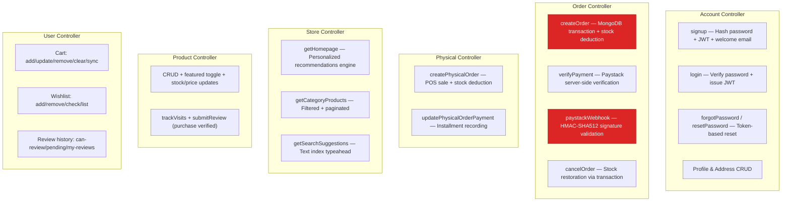

> [!NOTE]
> **Recommendation Engine** (`storeController.js` via `helpers.js`): The homepage endpoint accepts user preferences (tracked category visit frequencies + last 10 viewed product IDs) and returns personalized product sections using `getRecommendedProducts`, `getRandomCategoriesWithProducts`, and `getRecommendationType`.

> [!IMPORTANT]
> **Atomic Stock Operations**: Order creation, payment verification, cancellation, refund, and deletion all use **MongoDB sessions and transactions** to ensure stock counts remain consistent.

---

### 5.5 Authentication & Authorization

```mermaid
graph TD
    subgraph "User Auth Flow"
        US["POST /account/signup"] --> HP["bcrypt.hash - 10-12 rounds"]
        HP --> JWT1["jwt.sign - userId, email - 7d expiry"]
        JWT1 --> WE["Send Welcome Email via Brevo SMTP"]

        UL["POST /account/login"] --> VP["bcrypt.compare"]
        VP --> JWT2["jwt.sign - userId, email - 7d expiry"]
    end

    subgraph "Admin Auth Flow"
        AL["POST /admin/login"] --> AVP["bcrypt.compare + check isActive"]
        AVP --> JWT3["jwt.sign - id, email, role - 7d expiry"]
        JWT3 --> ULL["Update lastLogin timestamp"]
    end

    subgraph "Password Reset"
        FP["POST /forgot-password"] --> RT["jwt.sign - userId - 1h expiry"]
        RT --> RL["Email reset link"]
        RP["POST /reset-password"] --> VRT["jwt.verify + bcrypt.hash"]
    end

    style HP fill:#f59e0b,stroke:#d97706
    style JWT1 fill:#10b981,stroke:#059669,color:#fff
    style JWT2 fill:#10b981,stroke:#059669,color:#fff
    style JWT3 fill:#10b981,stroke:#059669,color:#fff
```

**Password Validation Rules** (`authUtils.js`):
- Minimum 8 characters
- At least 1 uppercase, 1 lowercase, 1 number, 1 special character

**Auth Middleware Chain**:
- `verifyTokenUser` → Decodes JWT, sets `req.user = { userId, email }`
- `verifyAdmin` → Decodes JWT, fetches active admin from DB, sets `req.admin`
- `verifyToken` → Generic token decode, sets `req.user = { id, email, role }`
- `requireRole(role)` → Checks `req.admin.role === role`
- `checkPurchase` → Ensures user has a delivered order with the target product

---

### 5.6 Real-Time (Socket.io)

| Event Name | Direction | Trigger | Payload |
|---|---|---|---|
| `new-notification` | Server → All Clients | New order, cancellation, low stock, payment, signup | Full notification object |
| `notifications-marked-all-read` | Server → All Clients | Admin marks all notifications read | `{ success: true }` |
| `product_updated` | Server → All Clients | Product edited via admin | Updated product object |
| `connection` | Client → Server | Client connects | Socket ID |
| `disconnect` | Client → Server | Client disconnects | Socket ID |

---

### 5.7 Payment Integration (Paystack)

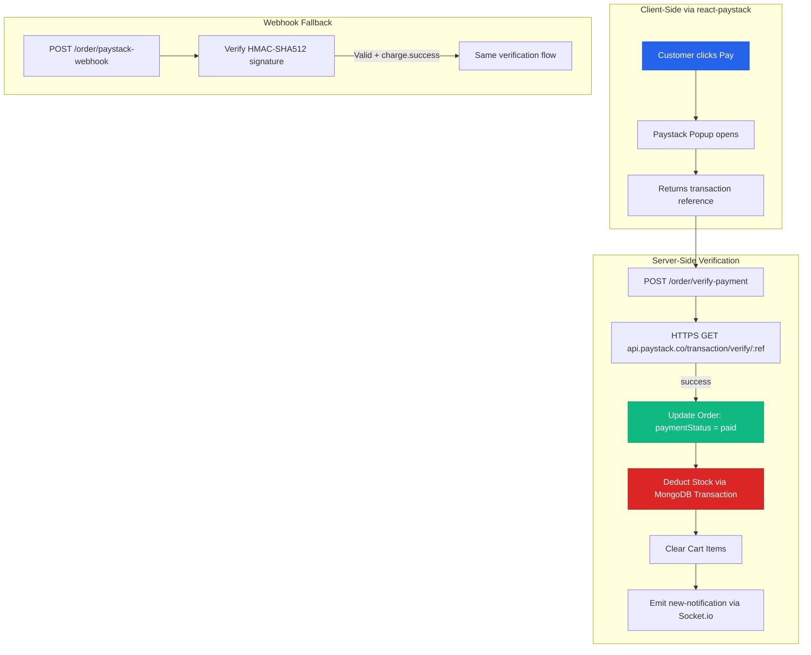

**Fee Calculation**: `2.2% + ₦100 NGN` gateway fee tracked/passed dynamically.

---

### 5.8 Email System (Nodemailer)

| Email Type | SMTP Provider | Trigger | Template Files |
|---|---|---|---|
| Welcome Email | **Brevo** (`smtp-relay.brevo.com:587`) | User signup | `newUserTemplate.js` + `user.html` |
| Order Confirmed | **Gmail** (`service: "gmail"`) | Payment verified | `orderConfirmedTemplate.js` + `confirmed.html` |
| Order Delivered | **Gmail** | Status → Delivered | `orderDeliveredTemplate.js` + `delivered.html` |
| Status Changed | **Gmail** | Any status transition | `statusChangedTemplate.js` + `status.html` |

Each email has both **HTML** (rich template) and **plaintext** fallback versions.

---

### 5.9 File Upload & Media

- **Multer**: Configured for local uploads to `upload/images/`
- **Cloudinary**: Product images stored as Cloudinary URLs in the `images: [String]` array
- **Admin Upload Flow**: Admin dashboard uploads directly to Cloudinary via `uploadImage()` (bypasses backend)

---

### 5.10 Utilities & Helpers

#### [`utils/helpers.js`](file:///c:/Users/Emma/Documents/code/Mclily/backend/utils/helpers.js)

| Category | Functions |
|---|---|
| **Recommendations** | `getRecommendedProducts`, `getRandomCategoriesWithProducts`, `getRecommendationType` |
| **Stock Control** | `updateProductStocks`, `restoreProductStocks`, `restoreProductStocksWithTransaction`, `restoreStocksByOrderId`, `filterOutOfStock` |
| **Cart & Wishlist** | `populateCart`, `getCartSummary`, `populateWishlist` |
| **Orders** | `getOrderSummary`, `populateUserOrders`, `handleOrderError` |
| **Payments** | `verifyPaystackPayment` — HTTPS call to Paystack verification API |

#### [`services/notificationService.js`](file:///c:/Users/Emma/Documents/code/Mclily/backend/services/notificationService.js)

| Method | Trigger |
|---|---|
| `newOrder(io, orderData)` | New order placed |
| `orderCancelled(io, orderData)` | Order cancelled |
| `lowStock(io, productData)` | Stock drops below threshold |
| `paymentProcessed(io, paymentData)` | Payment confirmed |
| `newSignUp(io, userData)` | New user registered |

---

### 5.11 Environment Variables

| Variable | Purpose |
|---|---|
| `MONGO_URI` | MongoDB connection string |
| `JWT_SECRET` | JWT signing secret |
| `FRONTEND_URL` | Frontend URL (CORS + password reset links) |
| `PORT` | Server port (default: 4000) |
| `PAYSTACK_SECRET_KEY` | Paystack secret key |
| `PAYSTACK_PUBLIC_KEY` | Paystack public key |
| `EMAIL_FROM` | Sender email address |
| `ADMIN_EMAIL` | Administrator notification email |
| `GMAIL_EMAIL` | Gmail for transactional emails |
| `GMAIL_APP_PASSWORD` | Gmail App Password |
| `BREVO_EMAIL` | Brevo SMTP sender |
| `BREVO_SMTP_KEY` | Brevo SMTP key |
| `NODE_ENV` | Environment (`development` / `production`) |

---

### 5.12 Error Handling & Safety

1. **Global Error Middleware**: [`errorhandler.js`](file:///c:/Users/Emma/Documents/code/Mclily/backend/middlewares/errorhandler.js) catches all unhandled Express errors
2. **Process-Level Handlers**: `unhandledRejection` and `uncaughtException` in `index.js`
3. **MongoDB Transactions**: Used in order creation, payment verification, stock operations for atomic rollback
4. **Standardized Response Format**: `{ success: true/false, message, data? }`

---

## 6. Customer Frontend Deep Dive

### 6.1 Routing Map

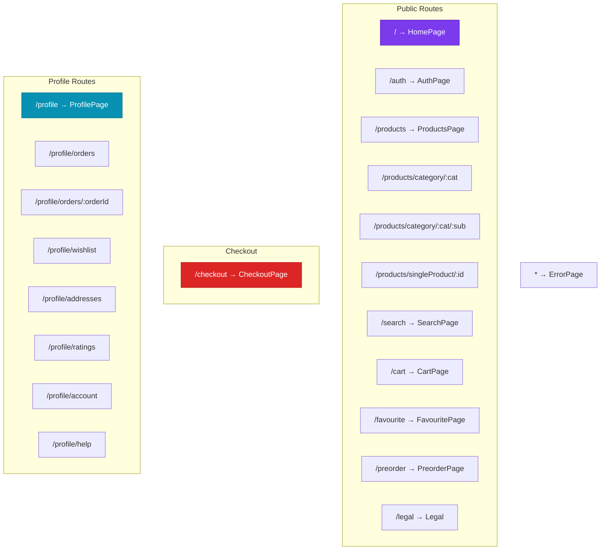

Additional product routes: `/products/subCategory/:sub`, `/products/all/:allSub`, `/products/:supriseMe`. Profile sub-routes: `/profile/addresses/new`, `/profile/addresses/:addressId`, `/profile/ratings/:productId`.

---

### 6.2 State Management Architecture

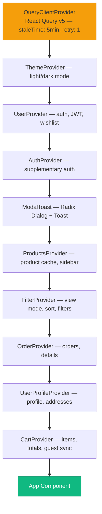

| Provider | Reducer | Key State |
|---|---|---|
| **ThemeProvider** | — | `theme`, syncs `localStorage` + DOM class |
| **UserProvider** | `user-reducer.js` | `user`, `isAuthenticated`, `token`, `wishlist` |
| **AuthProvider** | `auth-reducer.js` | Supplementary auth fields |
| **ModalToast** | — | Modal/toast visibility & config |
| **ProductsProvider** | `product-reducer.js` | `products` (dict by ID), `isSidebarOpen`, `activeLink` |
| **FilterProvider** | `filter-reducer.js` | `gridView`, `sort`, `filters` |
| **OrderProvider** | `order-reducer.js` | `orders`, `singleOrder` |
| **UserProfileProvider** | — | Profile, addresses, defaults |
| **CartProvider** | `cart-reducer.js` | `cart[]`, `totalItems`, `totalAmount`, `guestId` |

---

### 6.3 Custom Hooks (React Query)

#### Cart Hooks (`cartHooks.js`)
`useCart`, `useAddToCart`, `useUpdateCart`, `useRemoveFromCart`, `useClearCart`, `useSyncCart`

#### Order Hooks (`orderHooks.js`)
`useUserOrders`, `useOrderDetails`, `useSmartOrder` (cache-first), `useCancelOrder`, `useUpdateOrderStatus`, `useCreateOrder`, `useVerifyPayment`

#### Store Hooks (`storeHooks.js`)
`useHomepageData` (sends user preferences), `useInfiniteProducts` (infinite scroll), `useSmartProduct` (multi-layer cache check), `useSearchSuggestions` (debounced typeahead)

#### User Hooks (`userHooks.js`)
`useSignUp`, `useSignIn`, `useSignOut`, `useWishlist`, `useAddToWishlist`, `useRemoveFromWishlist`, `useCheckWishlist`, `useCanReview`, `usePendingReviews`, `useUserReviews`, `useUserAllReviews`

#### Product Hooks (`productHooks.js`)
`useSubmitReview`, `useUpdateReview`, `useDeleteReview`

#### Profile Hooks (`userProfileHooks.js`)
`useUserProfile`, `useUpdateProfile`, `useUserAddresses`, `useAddAddress`, `useUpdateAddress`, `useDeleteAddress`, `useSetDefaultAddress`, `useChangePassword`

---

### 6.4 API Layer

- **Axios Instance** ([`utils/axiosInstance.js`](file:///c:/Users/Emma/Documents/code/Mclily/frontend1/src/utils/axiosInstance.js)):
  - Base URL: `VITE_API_BASE_URL` (default `http://localhost:4000`), timeout: 40s
  - Request interceptor: JWT from `localStorage.getItem("profile")` → `Authorization: Bearer <token>`

- **6 Endpoint Modules**: `cartApi.js`, `orderApi.js`, `productsApi.js`, `storeApi.js`, `userApi.js`, `userProfileApi.js`

---

### 6.5 Pages & Features

#### HomePage
- Hero banner, FeaturedProducts, TopSellers, CategoryFirst/Second sections, RecommendedProducts (personalized), LastViewed (from localStorage), ProductCategorySection

#### AuthPage
- Animated tab switching (Framer Motion) between Login/Signup
- Real-time **Password Strength Meter** (Weak → Moderate → Strong)
- On signup: auto-login + cart sync

#### ProductsPage
- **Infinite scroll** via `useInfiniteProducts` + `react-intersection-observer`
- **Filter sidebar**: price range, brand, category, subcategory
- **Sort**: price-lowest, price-highest, name-a, name-z
- **View toggle**: Grid / List view
- Category-aware routing from URL params

#### SingleProductPage
- **Dynamic price** updates on variant selection
- **Stock warnings**: "few units left", "Out of Stock"
- **Visit tracking**: `trackProductView()` on load
- **Sticky mobile bottom bar**: Add to Cart + Wishlist
- Image gallery, size selector, description/specs tabs, delivery options, reviews, "You May Also Like"

#### CheckoutPage — Multi-Step Wizard

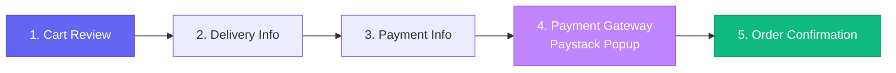

Components: `CheckoutProgress`, `CheckoutWizard`, `CartReview`, `DeliveryInfo`, `PaymentInfo`, `PaymentGateway`, `OrderSummary`, `OrderConfirmation`

#### Profile Pages
- **Orders**: Time filters (30d, 3/6mo), status filters, context-aware actions ("Track Order" if shipped, "Reorder" if delivered/cancelled)
- **OrderDetail**: Items, quantities, status timeline, shipping info
- **Wishlist**: Product grid with quick add-to-cart
- **AddressPage/AddressForm**: CRUD addresses, set default
- **Ratings/ProductRating**: Submit/edit reviews with star ratings
- **AccountManagement**: Edit profile, change password
- **Help**: FAQ section

#### Other Pages
- **FavouritePage**: Browse wishlisted products
- **PreorderPage**: Preorder system (partially implemented)
- **Legal**: Terms & privacy
- **SearchPage**: Full search with filters

---

### 6.6 Component Library

#### Navigation & Layout (10 components)
`Navbar`, `SearchBar` (300ms debounce, keyboard nav, "Popular Searches" fallback), `Sidebar` (mobile), `Footer`, `Categories`, `CategoryHeader`, `PageHero`, `ScrollToTop`, `ThemeToggle`, `About`

#### Product Components (9 components)
`ProductCard`, `Stars`/`Stars1`, `Gridview`, `Listview`, `ProductList`, `Sort`, `FiltersSidebar`, `SearchFiltersSidebar`, `AmountButtons`

#### Single Product (6 components)
`ProductImages`, `Size`, `DescSpec`, `DeliveryOptions`, `Reviews`, `YouMayLike`

#### Cart Components (7 components)
`CartContent`, `CartItem`, `CartColumn`, `CartTotal`, `CartNavbar`, `CartMayLike`, `Checkoutslide`

#### Checkout Components (8 components)
`CheckoutProgress`, `CheckoutWizard`, `CartReview`, `DeliveryInfo`, `PaymentInfo`, `PaymentGateway`, `OrderSummary`, `OrderConfirmation`

#### Homepage Sections (10 components)
`FeaturedProducts`, `TopSellers`, `CategoryFirst`, `CategorySecond`, `CategorySkeleton`, `ProductCard`, `ProductCategorySection`, `RecommendedProducts`, `LastViewed`

#### Profile Components (12 components)
`ProfilePage`, `ProfileNavbar`, `Orders`, `OrderDetail`, `Wishlist`, `AddressPage`, `AddressForm`, `Ratings`, `ProductRating`, `AccountManagement`, `Help`

#### Utility Components
`ImageWithFallback`, `IsAuthenticated`, `Loading`, `Error`, `EmptyCategory`, `DotLoader`, `MBlobLoader`, `MclilyLoader`, `SpinnerLoader`

---

### 6.7 E-Commerce Core Systems

#### Cart System Architecture

```mermaid
graph TD
    subgraph "Guest User"
        GA["Add to Cart"] --> LS["localStorage ecommerce_cart"]
        LS --> GID["guestId = guest_timestamp_random"]
    end

    subgraph "On Login"
        LOGIN["User Authenticates"] --> SYNC["useSyncCart"]
        SYNC --> MERGE["POST /user/cart/sync"]
        MERGE --> CLEAR["Clear localStorage cart"]
    end

    subgraph "Authenticated User"
        AA["Add to Cart"] --> API["POST /user/cart/add"]
        API --> DB["MongoDB user.cart"]
    end

    subgraph "Item Identification"
        CID["cartId = size ?<br/>productId_sizeValue : productId"]
    end

    subgraph "Stock Enforcement"
        SE["max qty = size ? size.stock : product.stock"]
    end

    style SYNC fill:#f59e0b,stroke:#d97706
    style MERGE fill:#10b981,stroke:#059669,color:#fff
```

#### Wishlist System
- Backend-synced via `/user/wishlist`, instant UI toggle via `isInWishlist(productId)` context helper

#### Recommendation Engine
- `trackProductView(productId)` stores last 10 viewed + category frequencies in `localStorage`
- Sent to `POST /store/homepage` for personalized results

#### Category Structure
Women, Men, Unisex, Teens & Kids, Babies, Accessories, Anime (special)

#### Review System
- Purchase-verified reviews via `checkPurchase` middleware
- `useCanReview`, `usePendingReviews`, submit/edit/delete lifecycle

---

### 6.8 UI/UX Patterns & Animations

| Pattern | Implementation |
|---|---|
| Framer Motion page transitions | Smooth enter/exit between routes |
| Animated auth tabs | Login ↔ Signup sliding transitions |
| Password strength meter | Real-time Weak/Moderate/Strong indicator |
| Debounced search (300ms) | Prevents API spam |
| Keyboard search nav | Arrow ↑/↓ in suggestions |
| "Popular Searches" fallback | Shown when no results |
| Infinite scroll | `react-intersection-observer` trigger |
| Sticky mobile cart bar | Fixed bottom on product pages |
| Swipe gestures | `react-swipeable` for mobile |
| Context-aware stock warnings | "Few units left", "Out of Stock" |
| Context-aware order actions | "Track" (shipped), "Reorder" (delivered) |
| Optimistic UI updates | React Query mutations |
| Custom branded loaders | Dot, Blob, McLily, Spinner |
| Radix confirmation modals | Destructive action protection |
| Radix toast notifications | Success/error/info/warning feedback |

---

### 6.9 Styling & Theme System

- **Tailwind CSS v4** with `@tailwindcss/vite` plugin
- **Dark mode**: `@custom-variant dark (&:where(.dark, .dark *))` — class-based toggle
- **Color palette**: `aquamine-1` through `aquamine-7`, `dark-background`, `dark-surface`, `dark-button`, `light-button`
- **Fonts** (Google Fonts): Cormorant, DM Sans, Lora, Poppins, Quicksand, Sevillana
- **CSS Animations**: `overlayShow`, `contentShow`, `slideIn`, `swipeOut`, `fadeIn`, `breathe`, `morph`, `float-around`, `bounce-dot`

---

## 7. Admin Dashboard Deep Dive

### 7.1 Routing Map

| Route | Page | Purpose |
|---|---|---|
| `/login` | `Login.jsx` | Admin login (public) |
| `/` | `Admin.jsx` | Dashboard home (protected) |
| `/products` | `AllProducts.jsx` | Product catalog + SidePane |
| `/add-product` | `AddProduct.jsx` | Product creation form |
| `/orders` | `Orders.jsx` | Order management |
| `/orders/:id` | `OrderDetails.jsx` | Online order detail |
| `/new-arrival` | `NewArrival.jsx` | New arrival intake |
| `/upload` | `PhysicalSalesForm.jsx` | POS sales form |
| `/notifications` | `Notifications.jsx` | Notification center |
| `/details` | `PhysicalOrderDetails.jsx` | Physical order detail |
| `/edit` | `StockPriceEdit.jsx` | Quick stock/price editor |
| `*` | `Error.jsx` | 404 fallback |

**Route Guard**: `ProtectedRoute` checks `isAuthenticated()`, redirects to `/login` preserving intended route.
**Deep Linking**: `AllProducts` reads `?productId=...&openPanel=true` for direct product inspection.

---

### 7.2 State Management Architecture

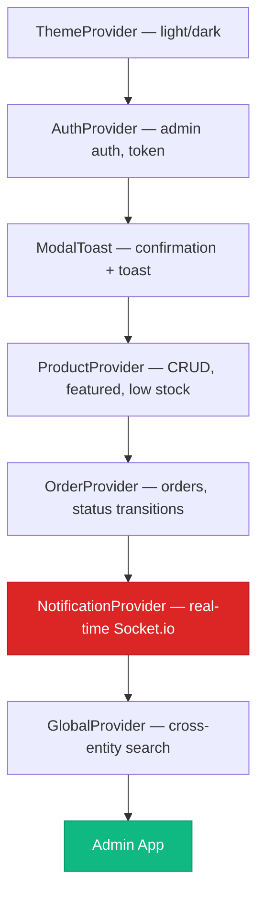

| Provider | Key State |
|---|---|
| **AuthProvider** | `isAuthenticated`, `admin`, `token`, token verification via `/admin/verify` |
| **ProductProvider** | `products`, `editProductData`, `isEditMode`, `lowStock` (≤10), `featuredProducts`, `bestSellers`, `topProducts` |
| **OrderProvider** | `orders`, `recentOrders`, `pendingOrders`, `completedOrders`, `singleOrder`, statuses: Pending→Processing→Shipped→Out_for_delivery→Delivered (or Cancelled/Returned/Refunded) |
| **NotificationProvider** | `notifications`, `unreadCount`, Socket.io `new-notification` listener, categories: user/system/payment/order/inventory/report |
| **GlobalProvider** | `searchTerm`, `results: { products, orders }`, debounced multi-entity search |
| **ModalToast** | Confirmation types: delete/remove/edit/add/approve/reject/archive; Toast: success/error/info/warning |

---

### 7.3 Custom Hooks

`useAuthContext`, `useProductContext`, `useOrderContext`, `useNotificationContext`, `useGlobalContext`, `useThemeContext`, `useModal`, `useToast`, `useMediaQuery(query)`

---

### 7.4 API Layer

- **Axios**: Base URL `VITE_API_BASE_URL`, timeout 50s, auto-injects `adminToken` Bearer
- **Endpoints**: `productsApi.js`, `ordersApi.js`, `notificationsApi.js`
- **Cloudinary Direct**: `uploadImage(file)` → Cloudinary API with preset `"mclily"`
- **Auth Helper**: `getToken()`, `setToken()`, `clearToken()` in `lib/auth.js`

---

### 7.5 Pages & Features

#### Dashboard Home (`Admin.jsx`)

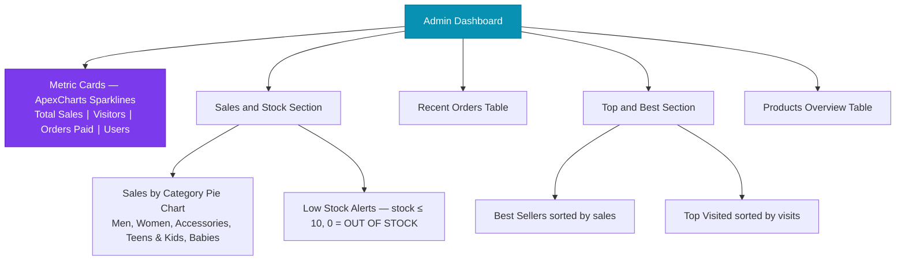

#### Product Management
- **AllProducts**: Master-detail with slide-out SidePane, URL deep linking, category filters, pagination
- **AddProduct**: Modular form — ProductName, BrandDesc, CatSub, PriceStock (variant-level), Specifications (dynamic key-value), TagsInput, Featured toggle, ImageUpload (drag-drop + @dnd-kit reorder → Cloudinary)
- **StockPriceEdit**: Quick search → inline stock/price updates for products or specific size variants

#### Order Management
- **Segmented views**: PendingOrders, RecentOrders, CompletedOrders, AllOrders
- **ChangeStatus modal**: Admin transitions orders through status lifecycle
- **PhysicalSalesForm (POS)**: Product search, size selection, live totals, full/credit payment, balance tracking
- **PhysicalOrderDetails**: Items, customer, payment summary, installment history, "Record New Payment" form

#### Notifications
- **Real-time Socket.io**: `new-notification` + `notifications-marked-all-read`
- **Filter tabs**: All | Unread | Read
- **Bulk actions**: Mark All Read, Clear Read
- **Priority colors**: 🔴 High, 🟡 Medium, 🟢 Low
- **Category icons**: user, system, payment, order, inventory, report

#### Other Pages
- **NewArrival**: New arrival collection form
- **ExcelUpload**: Bulk `.xlsx`/`.xls` import via dropzone
- **EditProduct**: Uses `isEditMode` in ProductContext

---

### 7.6 Component Library

#### Shell & Navigation (10 components)
`Layout`, `Sidebar` (collapsible desktop + mobile drawer), `Navbar` (300ms debounced global search), `User`, `Messages` (5 recent unread + badge), `GlobalSearchResults`, `ThemeToggle`, `Background`, `ScrollToTop`, `ErrorAlert`

#### Radix UI Wrappers (9 components in `ui/`)
`Accordion`, `button`, `command`, `dialog`, `dropdown`, `label`, `popover`, `radiogroup`, `select`

#### Product Form Components (12 in `addcomponents/`)
`ProductForm`, `ProductName`, `BrandDesc`, `CatSub`, `PriceStock`, `Specifications`, `TagsInput`, `Featured`, `ImageUplaod`, `Hamburger`, `test`

#### Dashboard Components (12 in `dashcomponents/`)
`Charts`, `ChartCard`, `SalesByCategory`, `LowStock`, `BestSellers`, `TopProducts`, `RecentOrders`, `ProductsOverview`, `FeaturedProducts`, `Sales&Stock`, `Top&Best`

#### Order Components (7 in `ordercomponents/`)
`AllOrders`, `PendingOrders`, `RecentOrders`, `CompletedOrders`, `ChangeStatus`, `PhysicalOrderUnpaid`

---

### 7.7 Analytics & Dashboard

| Visualization | Library | Data |
|---|---|---|
| Sparkline metric cards | ApexCharts | Total Sales, Visitors, Orders Paid, Users |
| Sales by Category pie chart | ApexCharts | Men, Women, Accessories, Teens & Kids, Babies |
| Best Sellers table | Custom | Sorted by `sales` |
| Top Visited table | Custom | Sorted by `visits` |
| Low Stock alerts | Custom | `stock ≤ 10`, flagged `OUT OF STOCK` at 0 |
| Recent Orders table | Custom | Latest orders with status badges |
| Products Overview | Custom | Full catalog summary |

---

### 7.8 UI/UX Patterns

| Pattern | Detail |
|---|---|
| Confirmation modals | Radix Dialog via `useModal()` — types: delete, remove, edit, add, approve, reject, archive |
| Toast notifications | Radix Toast — success, error, info, warning |
| Slide-out side pane | Right drawer for product inspection |
| URL deep linking | Product IDs + view states in URL params |
| Global search overlay | 300ms debounced, products + orders |
| Drag-and-drop image reorder | @dnd-kit `closestCenter` + `SortableContext` + `arrayMove()` |
| Collapsible sidebar | Desktop: `w-160` ↔ `w-fit`; Mobile: overlay |
| Responsive grids | Tailwind `max-md:grid-cols-1`, `flex-col md:flex-row` |
| Hidden scrollbars | `@utility scrollbar-hidden` |

---

### 7.9 Styling & Theme System

- **Tailwind CSS v4** with `@theme` directives in [`index.css`](file:///c:/Users/Emma/Documents/code/Mclily/admin/src/index.css)
- **Colors**: `aquamine-1` through `aquamine-7`, dark/light surface colors
- **Fonts**: Poppins, DM Sans, Lora, Cormorant
- **CSS Animations**: `overlayShow`, `contentShow`, `slideIn`, `breathe`, `morph`
- **Class Utilities**: `clsx` + `tailwind-merge` for conditional composition

---

## 8. Cross-Cutting Concerns

### Shared Patterns Across All Apps

| Concern | Implementation |
|---|---|
| JWT Authentication | Stateless Bearer tokens, 7-day expiry, bcrypt hashing |
| Axios Interceptors | Auto-inject Bearer token from localStorage |
| Theme System | Identical light/dark with `aquamine` palette |
| Radix UI | Shared Dialog, Toast, Select, Accordion |
| ScrollToTop | Both frontends restore scroll on route change |
| Custom Loaders | Matching DotLoader, MBlobLoader, MclilyLoader, SpinnerLoader |
| Error Handling | Standardized `{ success, message }` responses |
| Debounced Search | 300ms on search inputs in both apps |

### Data Flow Summary

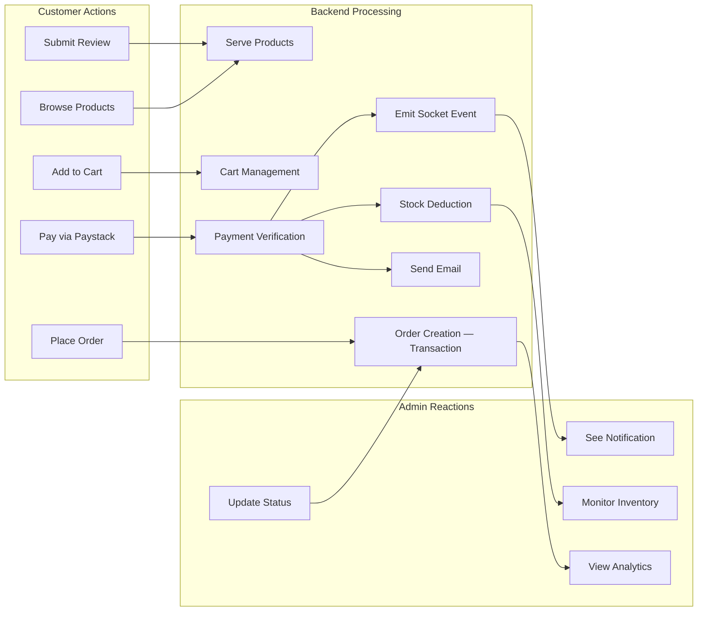

---

## 9. Current Limitations & Pain Points

> [!WARNING]
> These are architectural and code quality issues identified for the V2 rebuild:

### Architecture
- **No shared code**: Customer and Admin apps duplicate types, utilities, components, and theme config
- **No TypeScript**: Complex data structures (order schemas, payment calculations, product variants) lack type safety
- **SPA-only**: No SSR/SSG — poor SEO for product pages (critical for e-commerce)
- **No monorepo tooling**: Three separate `node_modules` with duplicated dependencies

### Backend
- **Unprotected routes**: `allUsers` and `deleteUser` have **no auth middleware** — security vulnerability
- **Mixed email providers**: Brevo for welcome, Gmail for orders — fragile, no unified abstraction
- **No test suite**: `"test": "echo \"Error: no test specified\""` — zero automated tests
- **Empty model file**: `accountModel.js` is an empty placeholder
- **Mixed media strategy**: Local multer uploads coexist with Cloudinary URLs — unclear approach
- **No API versioning**: Routes lack `/v1/` prefix for future compatibility
- **Rate limiter scope**: Global 400 req/hr may throttle legitimate heavy traffic

### Customer Frontend
- **Heavy context nesting**: 9+ nested providers create deep component trees
- **Dual state management**: React Context + React Query without clear boundary rules
- **Stripe SDK imported but possibly unused**: Listed alongside Paystack
- **PreorderPage partially implemented**: Feature exists but incomplete

### Admin Dashboard
- **No React Query**: Uses only Context + useReducer for all data fetching — no caching, no optimistic updates, manual loading/error states
- **Duplicate form structures**: `addcomponents`, `newcomponents`, `editcomponents` share similar form logic
- **Typo in filename**: `ImageUplaod.jsx` (should be `ImageUpload.jsx`)
- **Multiple icon libraries**: `lucide-react`, `@heroicons/react`, `react-icons` — should consolidate
- **No pagination metadata**: Admin product/order lists lack cursor-based or offset pagination from API
